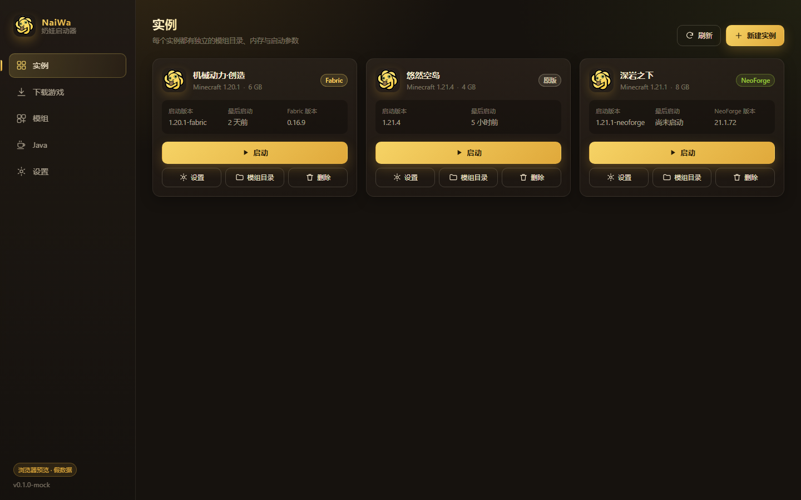
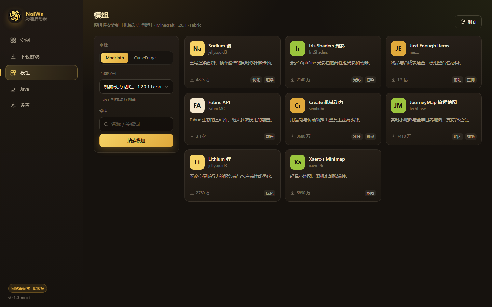
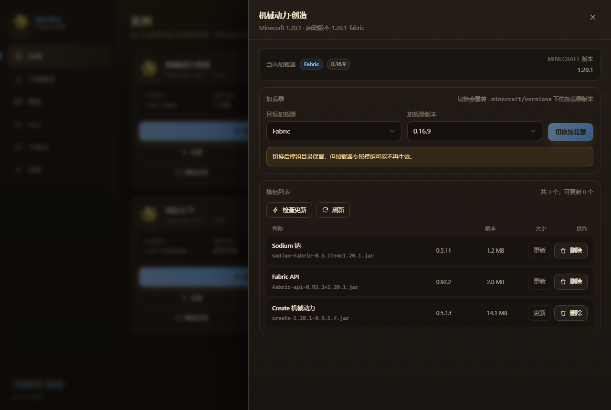
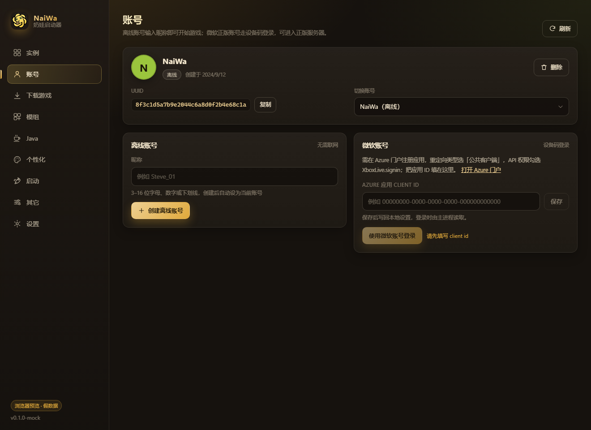
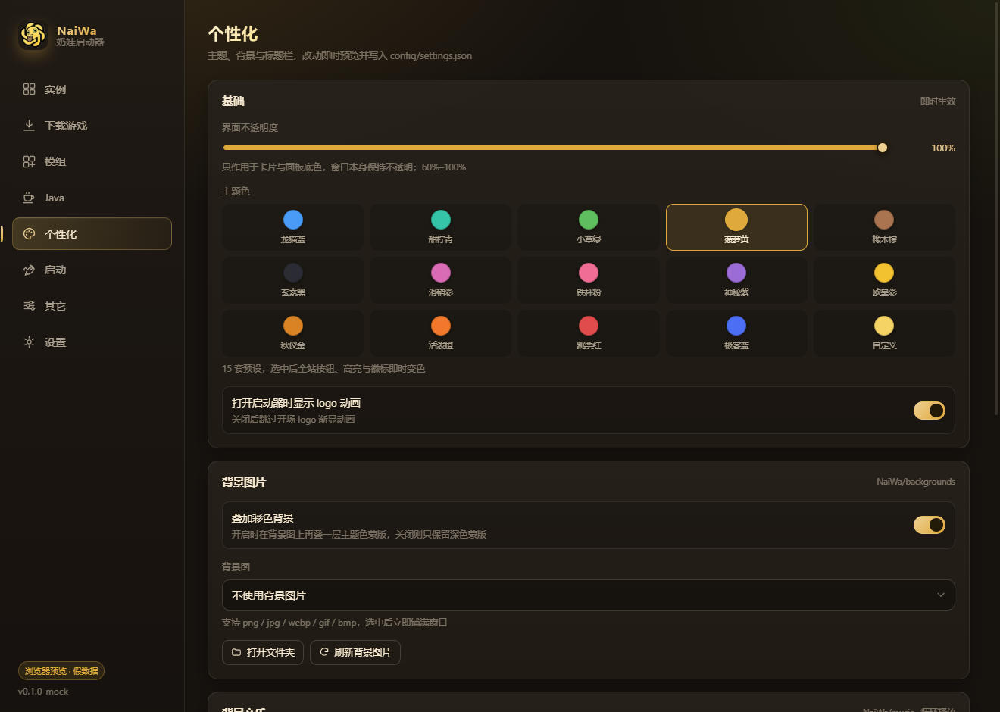
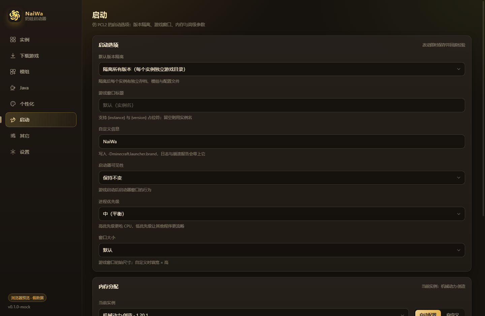
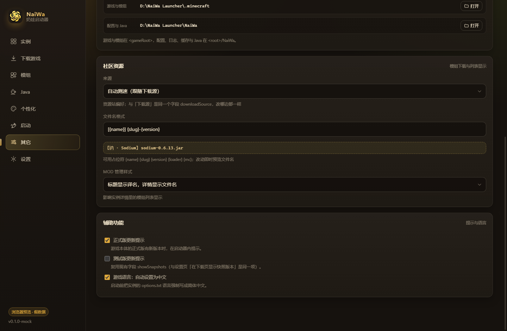

# 奶娃启动器 · NaiWa Launcher


现代化的 Minecraft 启动器（Windows x64）。程序显示名 **NaiWa Launcher**，界面内显示「奶娃启动器 / NaiWa Launcher」。当前版本 **0.3.4**。

主开发者 **奶龙** ｜ 协助开发者 **小七** ｜ 工具提供 **DeepSeek**

> 源码仓库：<https://github.com/JIJIGUOWANG123/NaiWaLauncher> ｜ 问题反馈：[Issues](https://github.com/JIJIGUOWANG123/NaiWaLauncher/issues) ｜ 更新日志：[CHANGELOG.md](CHANGELOG.md)

## 功能

### 游戏与实例
- 多版本 / 多实例管理，按实例隔离模组与存档；Fabric / Forge / NeoForge / Quilt / LiteLoader 安装与**一键切换**
- **存档直进**：列出现有单人存档（图标/大小/时间），点「进入」直接加载；也能新建存档并直接进入（1.20+ 的 quickPlay）
- 实例级内容管理：模组 / 光影包 / 资源包各自列表、检查更新、更新、删除（光影与资源包读 pack.mcmeta 说明），文件名模板可自定义；可搜索已装资源并单独删除
- **同时运行实例数**可设：默认只允许开一个，避免连点把内存吃满；需要多开改成「无限」
- **游戏内存优化**开关：开启后追加面向低延迟的 G1GC 参数（Aikar 风格），关掉只下发 `-Xms/-Xmx`；实例里的「额外 JVM 参数」始终最高优先

### 下载与资源
- 下载源：官方 / BMCLAPI / 上海交大（仅依赖库）/ FastMinecraftMirror / 自动测速；镜像缺件或不可达自动回源
- 多线程下载、**断点续传（关闭软件后重启会接着已下载的部分继续，进度与字节数持久化）**、全局限速
- **下载统一在「管理」页查看**：实时速度、已下载 / 总大小、失败原因，以及继续 / 终止 / 移除 / 清空已完成
- **可以同时安装多个模组**（排队进行）：真正同时下载的数量由设置里的「同时下载数」决定（默认 12，范围 1–32），超出部分排队等待
- **GitHub 加速下载**（「其它」页顶部）：粘贴 GitHub 地址即可加速下载，四个节点可选 —— `ghf.无名氏.top` / `gh.padao.fun` / `ghfast.top` / `github.cnxiaobai.com`
  - 默认**自动测速挑最快**，也可手动锁定某个节点，界面显示各节点实测延迟
  - 文件默认存到 **`<启动器根目录>\DL`**，可自行指定目录；重名自动加 `(1)`
  - 下载进度显示在「管理」页（与游戏/整合包下载同一套任务列表），可取消、可继续
- **资源列表支持翻页**：滚到底自动加载下一页（也可点「加载更多」），Modrinth / CurseForge / 麦块社区与地图列表都支持，跨页去重
- Modrinth 完整支持；CurseForge 支持「自备 Key」与「无 Key 粘贴链接」两种模式
- **前置依赖检查**：安装前解析必需前置（模组 / 光影包 / 资源包都查），已装的标「已安装」，缺失的可一键一并安装；光影按加载器规则补（Fabric/Quilt/NeoForge → Iris，Forge → Oculus）
- **中文搜索与实时翻译**（DeepL → uapis.cn → suapi.net 自动主备切换）：输入中文先译英文再检索，结果标题/简介实时回译（7 天本地缓存，可关闭）

### Java
- **六个 JDK 下载源 + 自动测速**：BellSoft Liberica / Adoptium (Temurin) / 清华 TUNA 镜像 / **Azul Zulu** / **Oracle JDK** / **Alibaba Dragonwell**
  - Oracle JDK 来自第三方镜像（`d10.injdk.cn`），**不参与自动测速**、只在手动选择时出现，并在界面标注其官方许可提示
  - 自动模式实测会优先选中 Dragonwell（阿里云 CDN 延迟最低），它是 OpenJDK 兼容发行版，跑 Minecraft 没有兼容问题
  - 下载后都会校验（Zulu/Oracle 按镜像给出的体积、Dragonwell 有官方 sha256 侧车），解压到 `NaiWa/java/<source>-<major>-<version>`
- 已装 JDK **来源识别**（标记文件 → 目录名前缀 → JDK 自带 release 文件 → 判定为系统安装），列表里显示来源徽标
- 每个实例可单独指定 Java；也可用「自动匹配 Java 版本」按游戏版本挑选（以版本 JSON 的 javaVersion 为准；兜底 ≤1.16.5→8、1.17–1.20.4→17、1.20.5–1.25→21、26.x 起→25）

### 账号
- 离线账号 / 微软正版账号（设备码登录）/ 第三方 Yggdrasil（authlib-injector）

### 皮肤与披风
- **本地皮肤/披风**：`NaiWa/skins`、`NaiWa/capes` 下放图片即可给离线账号使用（不必上传到皮肤站）；实例内可不装模组生效（可选本地皮肤 API）
- **内置皮肤/披风**：随程序分发的只读资源（`resources/skins`、`resources/capes`），界面里只能应用不能修改
- 第三方账号：只预览皮肤站上已装好的皮肤；微软账号：只预览官方皮肤与披风；自定义仅对离线账号开放
- 推荐素材站：皮肤 <https://littleskin.cn/> ｜ 披风 <https://mcstat.org/zh-Hans/skins/capes>

### 开服
- 内置服务端管理：从 **FastMirror**（<https://download.fastmirror.net>）按核心/版本/构建下载服务端，每台独立目录与配置
- 控制台实时输出（保留最近 2000 行）、`server.properties` 图形化编辑、一键启动/停止（停止失败会 `taskkill /T` 兜底）

### 背景与个性化
- **三种背景来源**：本地背景图（`NaiWa/backgrounds`）/ API 随机图 / Steam 壁纸引擎，各有独立开关、播放方式（单张/顺序/随机）与轮播间隔，另有一个总开关
- **每次启动随机一张**：三个来源各自可开启，启动时从该来源池子里随机取一张（与播放方式互不影响）
- **视频背景**：支持 mp4 / webm / ogv，可调音量（0 = 静音），与图片混合参与轮播
- **API 随机图**：默认关闭，自己填地址（可返回图片本身，或返回含图片地址的 JSON）；图片下载到 `NaiWa/cache/backgrounds` 并只保留最近 8 张
- **Steam 壁纸引擎**：自动探测 Steam 库并读取 `<Steam 库>\steamapps\workshop\content\431960`；**只识别视频与静态图两类壁纸**（`web` / `scene` 类型不列出——它们需要壁纸引擎自己的渲染器，列出来只会显示一张预览图误导人）；扫不到可在设置里手动指定目录
- 自绘标题栏（精简 / 图片）、界面图标可换 `NaiWa/icons`、整套换肤 + 自定义取色/渐变、透明度、背景音乐

### 联机（三种方式）
联机页有三种方式并存，按场景选：

| 方式 | 适合 | 说明 |
|---|---|---|
| **局域网直连** | 同一个局域网 | 直接填对方局域网地址；不需要额外组件 |
| **樱花穿透（natfrp）** | 长期开着的独立服务器 | 把本地 `25565` 通过公网 TCP 隧道暴露成固定地址，需要 Sakura FRP 令牌 |
| **陶瓦联机（Terracotta）** | 临时和朋友联机 | P2P + 邀请码：房主在游戏里「对局域网开放」，其他人用邀请码加入；不需要公网 IP 或端口映射 |

陶瓦联机的实现要点：

- 首次使用会**按需下载官方程序**（约 9.4MB，GitHub 优先、Gitee 镜像兜底，带 sha256 校验），放在 `NaiWa/tools/terracotta`
- 启动器只通过它的**本地 HTTP API**（`127.0.0.1` 随机端口）创建/加入房间，端口不暴露给渲染进程
- 界面有常驻版权标注：联机能力由 **Terracotta | 陶瓦联机** 提供 · 版权所有 © burningtnt 及贡献者 · AGPL-3.0-or-later · [项目主页](https://github.com/burningtnt/Terracotta)（依据其许可证的例外条款：原样分发未修改的二进制 + 只经 IPC 交互 + 界面标注版权）
- 若你**自己已经开着一个陶瓦**，启动器会识别并复用它的端口（界面会提示「已复用正在运行的陶瓦」），「断开复用」只断开连接、不会结束你那个实例
- 详细技术资料（接口、状态机、实测数据、风险）见 [docs/TERRACOTTA-FEASIBILITY.md](docs/TERRACOTTA-FEASIBILITY.md)

### 系统集成
- **单实例**：启动器只能开一个，再次双击会把已有窗口叫到前台并提示
- **托盘常驻**：右下角图标始终显示，随时点回界面；「关闭窗口时」可设为 询问我（首次）/ 隐藏到托盘 / 直接退出
- 启动 logo 淡入 → 渐变消失；**启动速度优化**（启动画面在第一个 await 之前创建、便携版解压一次后复用、语言包只保留中英、react 移出随包）
- **三语界面**：简体中文 / English / 日本語，设置里切换**立即生效**；主进程的报错与任务文案、数字与时间格式也会跟随语言

## 截图

| 实例 | 模组商店 | 实例详情（模组管理 / 加载器切换） |
|---|---|---|
|  |  |  |

| 账号 | 个性化 | 启动选项 | 其它设置 |
|---|---|---|---|
|  |  |  |  |

## 安装

### 安装版（推荐，支持自动更新）
1. 运行 `NaiWaLauncher-Setup.exe`（固定名，永远指向最新版；也可用带版本号的 `NaiWaLauncher-Setup-<version>.exe`）
2. 默认安装到 **`C:\Program Files\naiwa`**，可改成任意目录
3. 安装完成后**根目录会有一个 `NaiWa Launcher.lnk` 快捷方式**，桌面与开始菜单也会创建快捷方式

安装后的目录（程序与数据分开，数据都在根目录）：

```
<安装目录>\
  NaiWa Launcher.lnk       快捷方式（指向 main\NaiWa Launcher.exe）
  Uninstall.exe
  main\                    程序本体：NaiWa Launcher.exe + resources / locales / *.dll …
  .minecraft\              游戏数据：versions / libraries / assets / instances
  NaiWa\                   启动器数据：config / logs / meta / downloads / java / backgrounds / music / skins / capes
  servers\  skins\  capes\  服务端、用户皮肤、用户披风
```

> 因为数据与程序同级，而 `Program Files` 默认只读，安装器会给安装目录加「Users 可修改」权限（`icacls`）。
> 升级安装会先结束正在运行的旧版进程，再清理旧版平铺布局留下的程序文件；**卸载只删除 `main\` 与快捷方式，玩家数据一律保留**。

### 免安装版
- `NaiWaLauncher-<version>-portable-x64.zip`：解压到任意可写目录，双击其中的启动器即可用（无需管理员权限），把整个文件夹拷走即可带走数据
- `NaiWaLauncher-<version>-single-exe.exe`（与 Release 里的 `NaiWaLauncher.exe` 相同）：单文件自解压版。**首次启动需要解压**（约 280 MB 到 `%TEMP%\NaiWaLauncher`），之后复用解压缓存，只有版本变化才会重新解压

### 自动更新
- **安装版**：点「立即更新」会下载 Release 里的 `NaiWaLauncher-Setup.exe`，静默安装回**当前所在目录**，然后自动重启（数据原地不动）
- **免安装版**：下载新的 `NaiWaLauncher.exe` 替换自身后重启

## 账号

| 类型 | 说明 |
|---|---|
| 离线账号 | 输入 3–16 位字母/数字/下划线即可玩单人游戏与离线服；可用本地或内置皮肤/披风 |
| 微软正版 | 设备码登录。**需要自备 Azure 应用 client id**（重定向类型选「公共客户端」，API 权限勾选 `XboxLive.signin`），填在「账号 → 微软账号」里 |
| 第三方（Yggdrasil） | 填 API 根地址（如 `https://littleskin.cn/api/yggdrasil`）登录，启动时注入 authlib-injector |

> 项目不内置 CurseForge Key。
>
> **关于微软登录**：内置公共 client id 为 `fd3e219a-6e6a-4188-8a39-e241f0e63324`（可在「账号」页替换：**留空即用内置，填了就完全不再使用内置**）。设备码 → XBL → XSTS 三段实测通过；Minecraft 服务端会校验 Azure 应用是否通过 **AppID 审批**（[申请页](https://help.minecraft.net/hc/en-us/articles/16254801392141)），未审批的应用在 `login_with_xbox` 返回 `403 Invalid app registration`。审批通过后无需改代码。
>
> 未通过审批前，离线账号功能完全可用，但无法进入正版验证服务器。

## CurseForge 的两种用法

| 场景 | 能力 |
|---|---|
| 填了 API Key | 官方 API 全功能：关键词搜索、文件列表、检查更新、安装 |
| 不填 Key（默认） | 无 Key 模式：粘贴模组链接（如 `https://www.curseforge.com/minecraft/mc-mods/jei`）或项目 ID 即可解析并安装；**不支持关键词搜索**，下载走 forgecdn CDN（无哈希，只校验字节数） |

## 数据源

| 用途 | 地址 |
|---|---|
| 官方版本清单 | launchermeta.mojang.com / piston-meta.mojang.com |
| 镜像（整站） | bmclapi2.bangbang93.com（文档 bmclapidoc.bangbang93.com） |
| 镜像（仅依赖库） | mirror.sjtu.edu.cn/bmclapi（上海交大） |
| 镜像（分域名） | fastmcmirror.org（launchermeta / libraries / resources / forge / fabric 各自子域；本机偶发不可达，启动器会自动跳过并回退） |
| 模组 | api.modrinth.com / api.curseforge.com（可选 Key）/ api.cfwidget.com（无 Key 模式）/ 麦块社区 |
| Java | BellSoft Liberica（download.bell-sw.com，GitHub 兜底）/ Adoptium（api.adoptium.net，GitHub 兜底）/ 清华 TUNA（mirrors.tuna.tsinghua.edu.cn/Adoptium） |
| 服务端 | download.fastmirror.net API v3 |
| 皮肤站推荐 | littleskin.cn ｜ mcstat.org（披风） |

## 开发

```powershell
pnpm install
pnpm typecheck        # 主进程 + 渲染进程类型检查
pnpm build            # tsc 主进程 + vite 构建渲染进程
pnpm dev              # 渲染进程 http://localhost:5273
$env:NAIWA_DEV_URL="http://localhost:5273"; pnpm start   # 另开终端跑 Electron

node scripts/build-app.mjs           # 打包 --dir（产物 release/win-unpacked）
node scripts/build-installer.mjs     # 自研 NSIS 安装包（固定名 + 带版本号副本）
powershell -File scripts/build-zip.ps1   # 免安装 zip
node scripts/build-app.mjs --win portable --x64  # 单文件便携版
node scripts/export-source.mjs       # 导出 源代码/ 快照
```

技术栈：Electron 38 + React 19 + TypeScript(strict) + Vite 7；`asar: false`（应用为明文目录，不加壳不混淆）；主进程与渲染进程通过 `preload` 暴露的 `window.naiwa` 通信，契约集中在 `src/shared/{types,ipc}.ts`。架构细节见 [docs/ARCHITECTURE.md](docs/ARCHITECTURE.md)，杀毒误报说明见 [docs/AV-FALSE-POSITIVE.md](docs/AV-FALSE-POSITIVE.md)。

## 打包产物

| 文件 | 用途 |
|---|---|
| `NaiWaLauncher-Setup.exe` | 安装包（**固定名**，GitHub Release 与自动更新都认它） |
| `NaiWaLauncher-Setup-<version>.exe` | 同上，带版本号便于归档 |
| `NaiWaLauncher-<version>-single-exe.exe` | 单文件免安装版 |
| `NaiWaLauncher.exe` | 免安装版固定名（自动更新用，内容同上） |
| `NaiWaLauncher-<version>-portable-x64.zip` | 免安装压缩包 |

## 已知限制

- 仅 Windows x64；未做代码签名，首次运行可能有 SmartScreen 提示（见 [docs/AV-FALSE-POSITIVE.md](docs/AV-FALSE-POSITIVE.md)）
- 无 Key 模式的 CurseForge 只能按链接/ID 精确取项目，且没有哈希校验
- 微软账号需自行完成 AppID 审批才能登录正版服
- 切换「版本隔离」不会自动迁移已有模组目录
- 单文件便携版首次启动需要解压，比安装版慢；追求最快启动请用安装版或 zip
- 壁纸引擎只识别视频与静态图类型（scene / web 类型不渲染）；同目录内容需重启或点刷新才会重新扫描
- 三语覆盖界面与主进程文案，但**启动脚本正文、日志、代码注释**仍为中文；少数「前缀译文 + 后端原始响应」拼接的位置在英/日界面下会混排
- 模组名称、简介、日志等**数据**不做翻译
- 陶瓦联机依赖它的公共中继节点（实测出现过节点不可用，此时加入房间会报「连不上房主」）；节点列表目前是内置的，后续可做成可配置项
- 陶瓦每次运行会把约 21MB 的 EasyTier 组件释放到 `%TEMP%\terracotta`，启动器会在下次启动时清理超过 24 小时的历史目录
- Java 的 Oracle JDK 源来自第三方镜像、受 Oracle 官方许可约束，因此**不参与自动测速**、只在手动选择时出现；该镜像无可用性保证，列表改版时该源会显示为空（不会崩）

## 许可

MIT，见 [LICENSE](LICENSE)。开发者：**奶龙**。

## 杀毒软件误报

本程序不加壳、不混淆（`asar: false`，应用文件为明文目录），exe 版本信息完整。若被杀软报毒，多半是行为特征触发（例如可选的托盘、可选的进程优先级脚本、第三方账号必需的 authlib-injector 注入）——**这些敏感行为默认关闭**，需要时可在设置里开启。
误报申诉所需的完整行为清单与提交入口见 [docs/AV-FALSE-POSITIVE.md](docs/AV-FALSE-POSITIVE.md)。单文件便携版是自解压结构，如有误报请优先用 `Setup` 安装版或 `portable-x64.zip`。
